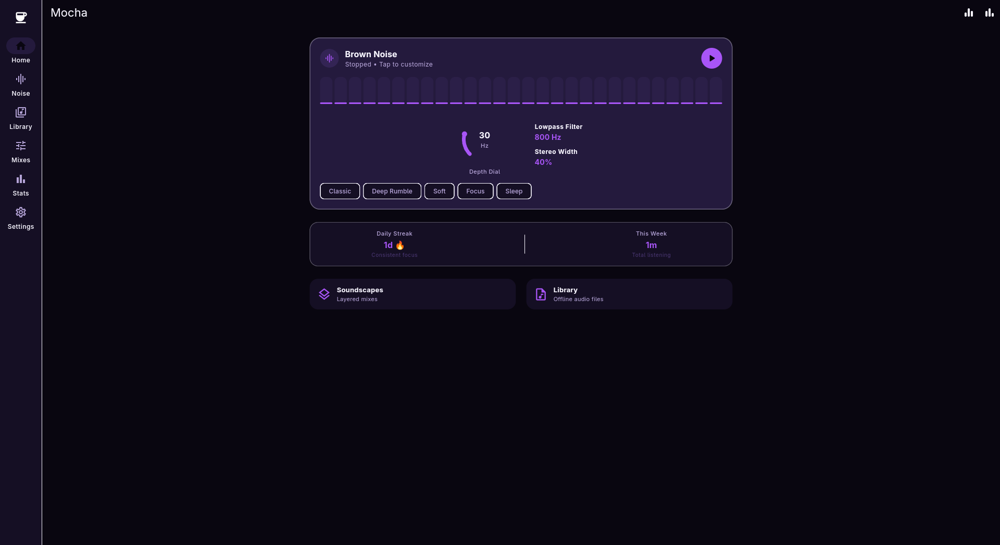
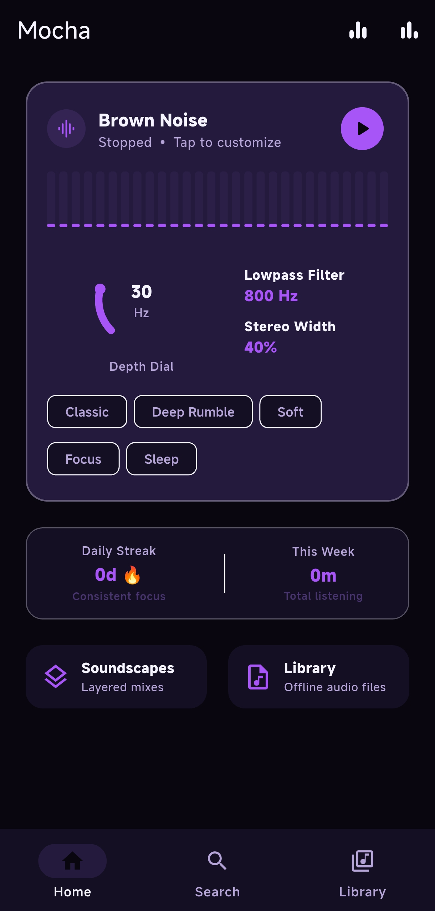

<p align="center">
  <h1 align="center">☕ Mocha</h1>
  <p align="center">
    <b>Offline brown noise generator & audio player</b><br>
    Pure math-driven noise synthesis · 8-band EQ · Soundscapes · Synced lyrics · Listening stats
    <b>Created with the help of a Agentic Workflow on AntiGravity</b>
  </p>
  <p align="center">
    
    
    
    
  </p>
</p>

---

## ✨ Features

| Feature | Description |
|---|---|
| **🎵 Brown Noise Engine** | Pure Dart DSP synthesis using leaky integration — no audio files, no network. 6 presets: Classic, Deep Rumble, Soft, Focus, Deep Sleep, Airplane Cabin. |
| **🎛️ Noise Studio** | Interactive rotational depth dial, low-pass filter, stereo width, and warmth controls with real-time parameter tuning. |
| **📊 Live Spectrum** | Animated FFT frequency visualizer (Radix-2 Cooley-Tukey with Hanning window) computed from actual synthesized audio buffers. |
| **🎚️ 8-Band Equalizer** | Parametric EQ powered by SoLoud filters — adjusts both generated noise and imported audio files simultaneously. |
| **🎼 Soundscapes** | Layer brown noise with up to 3 additional audio files. Save and restore mixes with a single tap. Adjustable crossfade (0–12s). |
| **📁 Local Library** | Import and play offline audio files (MP3, FLAC, WAV, OGG, AAC, MKA). Drag-and-drop support on desktop. |
| **🔁 Advanced Looping** | 5 loop modes: Off, Forever, Count, Duration, and A–B segment looping with tap-to-set markers. |
| **🎤 Synced Lyrics** | Auto-detects `.lrc` sidecar files, displays time-synced lyrics with tap-to-seek and active line highlighting. |
| **📈 Listening Stats** | Tracks sessions ≥ 5 seconds. Weekly duration bar chart, daily streak counter, and top sounds leaderboard. |
| **🖥️ Desktop Integration** | Linux MPRIS 2 D-Bus media controls, system tray with context menu, keyboard shortcuts (Space, arrows, L). |
| **📱 Android Background** | Foreground service with media notification, lock-screen controls, and media session integration. |
| **🌙 Sleep & Focus Timers** | Volume fade-out sleep timer and Pomodoro-style volume ducking for focus sessions. |
| **♿ Accessible** | Full semantics labels, scalable typography, and designed empty/error/permission state views. |

---

## 📸 Screenshot

> The app uses a dark obsidian-black theme with purple accents. Adaptive layout: sidebar navigation on desktop, bottom bar on mobile.

<p align="center">
  
  &nbsp;&nbsp;
  
</p>

---

## 🚀 Getting Started

### Prerequisites

- **Flutter SDK** ≥ 3.24.0 — [Install Flutter](https://docs.flutter.dev/get-started/install)
- **Dart SDK** ≥ 3.5.0 (bundled with Flutter)

#### Platform-specific

| Platform | Requirements |
|---|---|
| **Linux** | `clang`, `cmake`, `ninja-build`, `pkg-config`, `libgtk-3-dev`, `libasound2-dev`, `libappindicator3-dev` |
| **Windows** | Visual Studio 2022 with C++ desktop workload |
| **Android** | Android SDK 36+, `cmdline-tools`, JDK 17 |

### Clone & Install

```bash
git clone https://github.com/yourusername/mocha.git
cd mocha
flutter pub get
```

### Generate Drift Database Code

```bash
dart run build_runner build --delete-conflicting-outputs
```

---

## 🏗️ Build & Run

### 🐧 Linux

```bash
# Debug
flutter run -d linux

# Release
flutter build linux --release
./build/linux/x64/release/bundle/mocha
```

#### Install to App Launcher

```bash
# Copy desktop entry
cp packaging/linux/mocha.desktop ~/.local/share/applications/
# Update Exec= path inside the .desktop file to point to your release bundle
update-desktop-database ~/.local/share/applications
```

### 🪟 Windows

```bash
# Debug
flutter run -d windows

# Release
flutter build windows --release
# Output: build\windows\x64\runner\Release\mocha.exe
```

### 🤖 Android

```bash
# Debug on connected device
flutter run

# Release APK
flutter build apk --release
# Output: build/app/outputs/flutter-apk/app-release.apk

# Install on device
adb install -r build/app/outputs/flutter-apk/app-release.apk
```

---

## 📂 Project Structure

```
mocha/
├── lib/
│   ├── main.dart                    # Entry point
│   ├── app.dart                     # Router & MaterialApp
│   ├── core/
│   │   ├── theme/mocha_theme.dart   # Obsidian purple theme
│   │   ├── shell/adaptive_shell.dart # Responsive nav layout
│   │   └── widgets/state_views.dart  # Empty/error/permission views
│   ├── domain/                      # Pure models (no Flutter imports)
│   │   ├── noise_params.dart        # DSP parameters & presets
│   │   ├── audio_engine.dart        # Abstract engine interface
│   │   ├── loop_config.dart         # Loop mode definitions
│   │   ├── eq_config.dart           # Equalizer band config
│   │   ├── lrc_parser.dart          # LRC lyrics parser
│   │   ├── saved_mix.dart           # Soundscape persistence
│   │   └── mix_model.dart           # Mix state model
│   ├── audio/                       # Audio engine layer
│   │   ├── dsp/
│   │   │   ├── brown_noise_synthesizer.dart  # Leaky integrator DSP
│   │   │   └── spectrum_analyzer.dart        # FFT analyzer
│   │   ├── soloud_audio_engine.dart  # SoLoud implementation
│   │   ├── loop_controller.dart      # Loop logic & DB persistence
│   │   ├── volume_controller.dart    # Sleep fade & Pomodoro duck
│   │   └── providers.dart            # Riverpod providers
│   ├── data/
│   │   ├── database.dart             # Drift SQLite schema (v6)
│   │   ├── database.g.dart           # Generated code
│   │   ├── importer.dart             # Track import logic
│   │   └── providers.dart            # DB providers
│   ├── features/
│   │   ├── home/home_screen.dart     # Hero card & quick actions
│   │   ├── noise/                    # Noise Studio (dial, presets, spectrum)
│   │   ├── library/library_screen.dart
│   │   ├── player/                   # Now Playing, MiniPlayer, loop/timer sheets
│   │   ├── mixes/                    # Soundscape builder & manager
│   │   ├── eq/                       # 8-band parametric EQ
│   │   ├── lyrics/lyrics_screen.dart # Synced LRC display
│   │   └── stats/                    # Listening stats & session recorder
│   └── platform/
│       ├── mocha_audio_handler.dart   # MPRIS2 / Android media session
│       └── linux_tray_service.dart    # System tray & window management
├── android/                          # Android runner
├── linux/                            # Linux runner (single-instance)
├── windows/                          # Windows runner
├── test/                             # Unit tests
│   ├── brown_noise_test.dart
│   ├── loop_controller_test.dart
│   └── lrc_parser_test.dart
├── packaging/linux/mocha.desktop     # Freedesktop launcher entry
├── tool/build_appimage.sh            # AppImage build script
└── pubspec.yaml
```

---

## 🧪 Tests

```bash
flutter test
```

Tests cover:
- **Brown noise synthesis** — verifies output amplitude range and spectral rolloff
- **Loop controller** — tests all 5 loop modes with in-memory SQLite
- **LRC parser** — validates timestamp parsing, edge cases, and seek behavior

---

## 🔧 Tech Stack

| Component | Technology |
|---|---|
| Framework | Flutter 3.50 (Material 3) |
| State | Riverpod 2 |
| Routing | go_router |
| Audio Engine | SoLoud (via flutter_soloud) |
| Media Session | audio_service (MPRIS 2 + Android) |
| Database | Drift (SQLite) |
| DSP | Pure Dart (leaky integrator, Cooley-Tukey FFT) |
| Desktop | window_manager, tray_manager, desktop_drop |

---

## 🤝 Contributing

1. Fork the repo
2. Create a feature branch (`git checkout -b feat/your-feature`)
3. Commit changes (`git commit -m "feat: add your feature"`)
4. Push to the branch (`git push origin feat/your-feature`)
5. Open a Pull Request

---

## 📄 License

This project is licensed under the MIT License. See [LICENSE](LICENSE) for details.

---

<p align="center">
  Built with pure math
</p>
